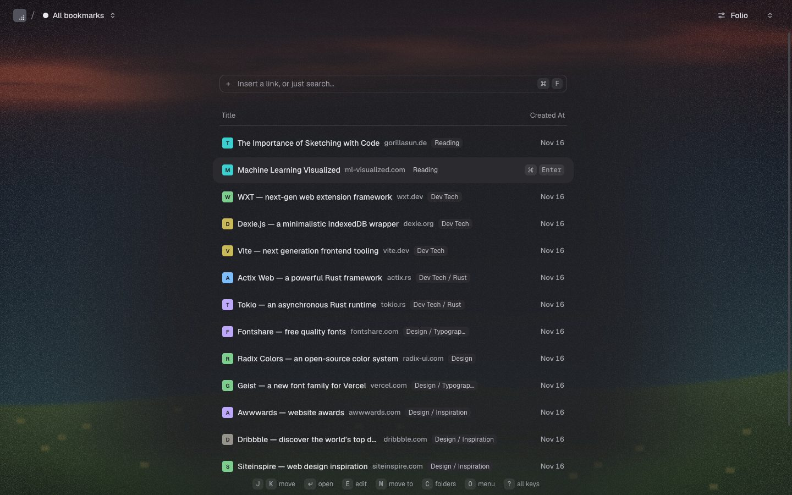
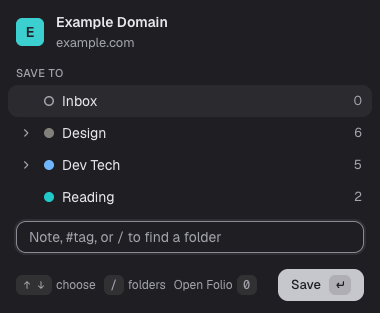
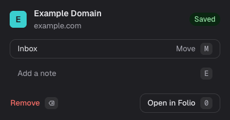

<h1 align="center">Folio</h1>

<p align="center">
  A fast, keyboard-first bookmark manager that sits on top of your browser's own bookmarks.<br />
  Local-first. No account, no server, no telemetry.
</p>

<p align="center">
  <a href="https://github.com/CinematicGenius007/folio/actions/workflows/ci.yml"></a>
  <a href="LICENSE"></a>
  <a href="https://folio.cinematicgenius007.com"></a>
</p>

<p align="center">
  
</p>

Folio does not keep a second copy of your bookmarks. It reads and writes the browser's **native bookmark tree**, so
everything you save shows up in the browser's own bookmark bar and syncs the way it already does. Folio adds the parts
browsers lack: instant search, nested folders you can drive from the keyboard, tags and notes, and undoable deletes.

Works in **Chrome, Edge, Brave, Arc, Dia and other Chromium browsers**, and in **Firefox and Zen**.

## Features

- **Your bookmarks stay yours.** Folio is a view over the native tree; uninstall it and every bookmark is still there.
- **Keyboard first.** Save with `Alt+S`, move with `J`/`K`, switch folders with `C`, open the menu with `O`. Press `?` for all of them.
- **Real nested folders.** Navigate them like a file manager, find any folder by typing part of its name, move bookmarks with a tree picker.
- **Instant search** over titles, URLs, tags, notes and folder paths, with fuzzy matching.
- **Tags and notes**, stored locally, with JSON backup and restore.
- **Safe deletes.** Deleted bookmarks are kept for 30 days and restore with `Z`, including their tags and notes.
- **Duplicate aware.** Saving a page you already saved shows where it lives, ignoring tracking parameters and `#fragments`.
- **Favicons that just work.** Chromium uses the browser's own icon cache. Firefox and Zen fetch and cache icons locally. Missing icons get a stable letter tile.
- **Two themes and your own background.** Overcast (light) and Dusk (dark), with generated backgrounds, including the painted Meadow and halftone Marble, or your own image.
- **Popup, full page and side panel**, all from the same code.

<p align="center">
  
  
</p>

## Install

Folio is not on a browser store yet. Install it from a release or build it yourself in a minute. The short version:

| Browser                       | Steps                                                                                                                            |
| ----------------------------- | -------------------------------------------------------------------------------------------------------------------------------- |
| Chrome, Edge, Brave, Arc, Dia | Open `chrome://extensions`, turn on **Developer mode**, click **Load unpacked**, pick the `chrome-mv3` folder.                   |
| Firefox, Zen                  | Open `about:debugging#/runtime/this-firefox`, click **Load Temporary Add-on**, pick `manifest.json` in the `firefox-mv2` folder. |

Firefox and Zen only keep temporary add-ons until restart. For a permanent install see [docs/INSTALL.md](docs/INSTALL.md),
which also covers downloading a release and building from source.

## Keyboard shortcuts

| Where     | Keys                    | Action                                  |
| --------- | ----------------------- | --------------------------------------- |
| Anywhere  | `Alt+S`                 | Save the current page (opens the popup) |
| Anywhere  | `Alt+Shift+F`           | Open the dashboard                      |
| Anywhere  | `Alt+Shift+B`           | Toggle the side panel or sidebar        |
| Popup     | `1`-`9`, `↑` `↓`, `↵`   | Pick a folder and save                  |
| Popup     | `/`                     | Search every folder, at any depth       |
| Popup     | `0`                     | Open the dashboard (works on any page)  |
| Popup     | `E`                     | Edit the note and #tags of a saved page |
| Popup     | `Tab`                   | Complete a #tag (also in the Edit box)  |
| Dashboard | `J` `K` or `↓` `↑`      | Move through the list                   |
| Dashboard | `↵`, `⇧↵`               | Open, open in the background            |
| Dashboard | `L` `→`, `H` `←`        | Enter a folder, go up                   |
| Dashboard | `C`, `O`                | Folder switcher, Folio menu             |
| Dashboard | `E`, `M`, `X`, `⌫`, `Z` | Edit, move, select, delete, undo        |
| Dashboard | `⌘F` `⌘K` `/`           | Search, or paste a link to save it      |
| Dashboard | `?`                     | Every shortcut                          |

The global shortcuts can be changed in your browser's extension shortcut settings (`chrome://extensions/shortcuts`,
or `about:addons` → ⚙ → **Manage Extension Shortcuts** in Firefox and Zen).

## How it works, in one paragraph

Pages read an IndexedDB copy of your bookmarks through Dexie live queries, and never ask the browser for reads. Changes
go straight to the browser's bookmark API. A background script watches bookmark events and is the **only** thing that
updates the IndexedDB copy, by re-reading the tree and writing the differences. That one-way loop keeps every page
consistent and makes the whole thing easy to test. The details are in [docs/ARCHITECTURE.md](docs/ARCHITECTURE.md).

## Privacy

Everything stays on your device. Folio has no server, no account, no analytics and no network calls of its own,
except one: **on Firefox and Zen only**, it fetches the favicon of each site you have bookmarked, directly from that
site, to show an icon. See [docs/PRIVACY.md](docs/PRIVACY.md) for every permission and why it is needed.

## Develop

```sh
pnpm install
pnpm dev            # Chromium, with hot reload
pnpm dev:firefox    # Firefox
pnpm check          # formatting, lint, types and unit tests
pnpm e2e:chromium   # end-to-end tests in a throwaway Chromium profile
pnpm e2e:firefox    # the same for Zen or Firefox (set ZEN_BIN or FIREFOX_BIN)
```

Read [CONTRIBUTING.md](CONTRIBUTING.md) for the project layout, conventions and how to add a feature. Bug reports and
ideas are welcome as [issues](https://github.com/CinematicGenius007/folio/issues), or by email at
[folio@cinematicgenius007.com](mailto:folio@cinematicgenius007.com).

## Documentation

User guides live on the website, [folio.cinematicgenius007.com/docs](https://folio.cinematicgenius007.com/docs) (source in [`site/`](site/README.md)). For contributors:

- [Installing](docs/INSTALL.md): every browser, releases, building, permanent Firefox and Zen installs
- [Architecture](docs/ARCHITECTURE.md): data flow, modules, the favicon pipeline
- [Testing](docs/TESTING.md): unit tests, end-to-end tests, testing on Zen
- [Design](docs/DESIGN.md): themes, colour tokens, interaction principles
- [Privacy](docs/PRIVACY.md): permissions and network behaviour
- [Chrome Web Store listing](docs/CHROME-STORE.md): listing text, permission justifications, images
- [Releasing](docs/RELEASING.md): private signing, automatic updates, cutting a release
- [Security policy](SECURITY.md) · [Code of conduct](CODE_OF_CONDUCT.md) · [Changelog](CHANGELOG.md)

## License

[MIT](LICENSE). Contributions are accepted under the same license.
