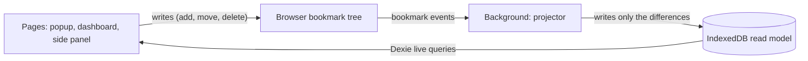
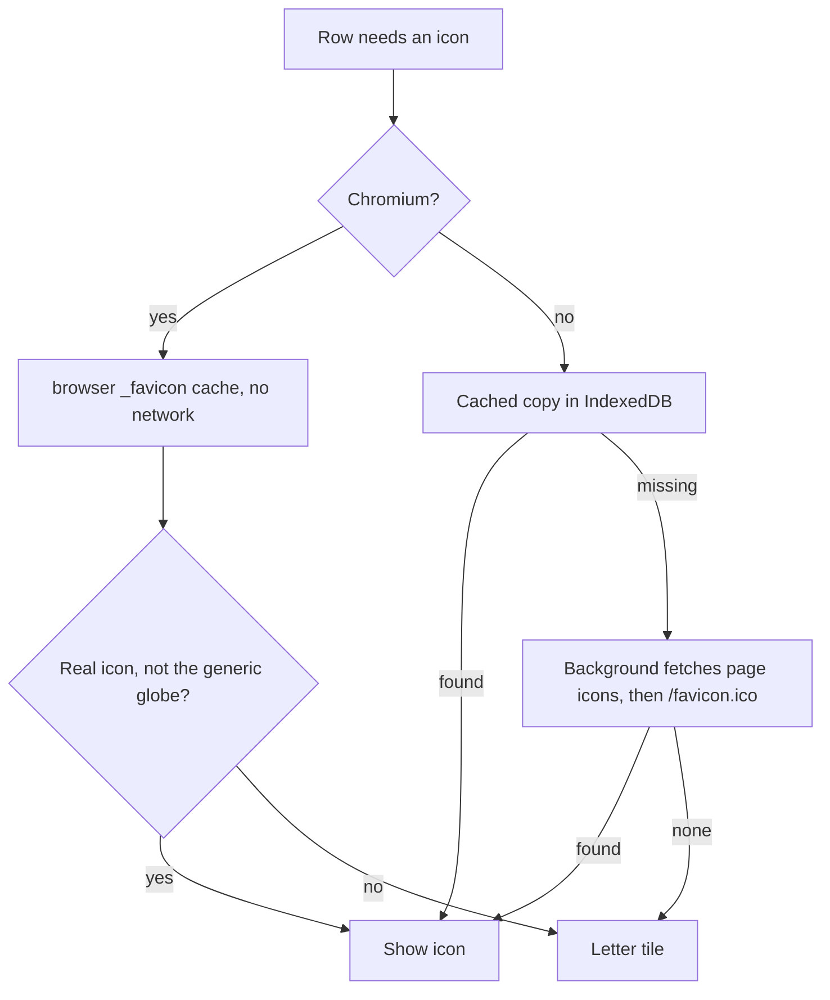

# Architecture

Folio is a [WXT](https://wxt.dev) web extension written in TypeScript with React. One codebase builds for Chromium
(Manifest V3, service worker) and Firefox/Zen (Manifest V2, event page).

The design rule that shapes everything: **the browser's bookmark tree is the source of truth, and data flows one way.**

## The one-way loop



_Pages never read the browser's bookmark API and never write the read model. The background script is the only writer of the read model._

| Part                                        | Role                                                                                                                                      |
| ------------------------------------------- | ----------------------------------------------------------------------------------------------------------------------------------------- |
| **Native bookmark tree**                    | Source of truth. Folio never owns your bookmarks, so uninstalling loses nothing but tags and notes.                                       |
| **Commands** (`lib/actions`)                | Every change a user makes. They call `browser.bookmarks.*` and, for tags and notes, write IndexedDB.                                      |
| **Projector** (`entrypoints/background.ts`) | Re-reads the tree after bookmark events and writes the _differences_ into the read model. Idempotent, so a missed event heals itself.     |
| **Read model** (IndexedDB via Dexie)        | `bookmarks`, `folders`, `meta`, `tombstones`, `favicons`, `settings`. Rebuildable from the tree, except `meta`, `tombstones`, `settings`. |
| **Pages** (`components/`)                   | Render the read model with `useLiveQuery`; every open page updates live when it changes, in any context.                                  |

Why this shape:

- **One writer** to the read model means no merge logic and no two-way sync bugs.
- **Reads are local and instant.** Search, counts and folder trees come from memory, not from walking the browser API.
- **Re-read and diff** instead of per-event patching. `bookmarks.onMoved` and friends only say "something changed"; one
  `getTree()` and a diff handles any combination of events, an import of 500 bookmarks, or events missed while the Chromium service worker slept.
- **Testable.** The projector, tree builder and command layer are plain functions tested without a browser.

## Schema changes

`bookmarks` and `folders` are a rebuildable read model; `meta`, `tombstones` and `settings` are user data. When a read-model row gains a field, bump the Dexie version in `lib/core/db.ts` and clear those two tables in `upgrade()`; the projector refills them within a second. `db.test.ts` shows the pattern.

## What is stored where

| Data                          | Lives in               | Survives uninstall?      |
| ----------------------------- | ---------------------- | ------------------------ |
| Bookmarks, folders, order     | Browser bookmark tree  | Yes, it is the browser's |
| Tags, notes                   | IndexedDB `meta`       | No (use _Back up_)       |
| Deleted bookmarks (30 days)   | IndexedDB `tombstones` | No                       |
| Settings, background image    | IndexedDB `settings`   | No                       |
| Cached favicons (Firefox/Zen) | IndexedDB `favicons`   | No (re-fetched)          |
| Theme choice (per page)       | `localStorage` mirror  | No                       |

`meta` rows are keyed by the native bookmark id. Backups are keyed by **URL**, because ids differ between browser profiles.

## Module map

```
entrypoints/        Thin WXT entry files: background, popup, dashboard, side panel
lib/
  core/             Browser-independent logic. No React, no browser API.
    types.ts          Data model (Bm, Folder, Meta, Tombstone, FaviconRow)
    db.ts             Dexie schema and the settings helpers
    projector.ts      Tree -> read model: flatten() and syncReadModel() with tombstones
    scheduler.ts      Debounced, non-overlapping sync runs
    tree.ts           Folder tree and the rows a folder picker shows
    search.ts         MiniSearch index over titles, URLs, tags, notes and paths
  actions/          Everything that changes data: bookmarks, tags and notes, backup
  favicon/          Letter-tile palette, Chromium icon cache, site fetcher, network guard
  react/            Hooks: useLibrary, useSetting, useBackground, useTheme, useObjectUrl
  util/             URL safety and normalisation, date formatting
components/
  dashboard/        The bookmark browser: entries (pure), keymap (pure), TopBar, Omnibar, Rows, hooks
  popup/            The toolbar popup: SavePanel and SavedPanel
  folders/          The shared folder picker: usePicker and FolderList
  menus/            Folder switcher, Folio menu, row context menu
  dialogs/          Edit, move, delete, settings, help
  backdrop/         Dither, marble and meadow backgrounds (pure maths + canvas)
  favicon/          Site icon with letter-tile fallback
  ui/               Button, Dialog, Toast, keycaps, icons
styles/theme.css    Design tokens for both themes, Tailwind v4 theme mapping
e2e/                End-to-end tests for Chromium and Firefox/Zen
scripts/            Icon and screenshot generators
```

Dependency direction is strictly `components -> lib/react -> lib/{actions,core,favicon,util}`; `lib/core` imports nothing from the others except small pure helpers.

## The projector

`syncReadModel(db, tree)` in `lib/core/projector.ts`:

1. `flatten()` turns the native tree into `Bm` and `Folder` rows. Children of the tree root are the _roots_ (Bookmarks bar, Other bookmarks); their direct child folders are **collections**; deeper folders nest. Each row carries `path` (titles) and `pathIds` (ids), so a folder view can include everything beneath it.
2. It diffs against the stored rows inside one Dexie transaction and writes only what changed, so live queries do not re-fire for nothing.
3. Bookmarks that vanished get a **tombstone** with their tags and notes. Tombstones older than 30 days are purged. Undo (`restoreTombstones`) recreates the bookmark, in its old folder or the Inbox if that folder is gone.

`createSyncScheduler` (`lib/core/scheduler.ts`) debounces bursts (120 ms), never runs two syncs at once, queues exactly one more if asked mid-run, and pauses during browser import events.

## The dashboard

`Dashboard.tsx` owns view state and wires pure pieces together:

- `crumbTrail()` and `collapseTrail()` (`crumbs.ts`) build the folder breadcrumb in the top bar.
- `buildEntries()` decides the list: all bookmarks, or a folder's subfolders then bookmarks, or ranked search results.
- `handleKey()` in `keymap.ts` is a pure function from a key event and a state snapshot to a call on an actions object. It is unit-tested without a DOM.
- `useBookmarkActions` performs moves, deletes (with undo toasts), copy and icon refresh.
- Reads come from `useLibrary()`. Writes go through `lib/actions`.

Folder navigation is a `filter` (`'all'` or a folder id). A deleted folder falls back to `'all'` without effects.

## Favicons



- **Chromium:** the `favicon` permission exposes the browser's icon cache at `/_favicon/`. It only knows pages you visited, and returns a generic globe otherwise; Folio fingerprints that globe and shows a tile instead.
- **Firefox and Zen:** no such API exists. The background script fetches each bookmarked site's declared icon (best size, SVG preferred), falls back to `/favicon.ico`, normalises rasters to 64 px, and caches them per origin (hits for 30 days, misses for 7).
- **Guard:** the fetcher only talks to public hosts over http(s), without credentials. `localhost`, private, link-local and reserved ranges (IPv4, IPv6, IPv4-mapped IPv6), `.local` and single-label names are refused (`lib/favicon/network.ts`). Downloads are streamed and cut off at a byte budget, time out after 6 s, and are discarded if a redirect lands on a private address (`fetchLimited` in `lib/favicon/cache.ts`).
- Icons that are dark on transparent get a light plate in the dark theme.

## Theming and backgrounds

`styles/theme.css` defines every colour as a CSS variable for two themes (`:root` for Overcast, `:root[data-theme='dark']` for Dusk) and maps them into Tailwind v4 with `@theme inline`. Components use semantic names (`bg-ground`, `text-muted`), never raw colours. See [DESIGN.md](DESIGN.md).

Backgrounds are generated, not images: `components/backdrop` has pure density and colour functions (`dither.ts`, `marble.ts`, `meadow.ts`) and canvas components that draw them. A user image is stored as a Blob and shown dimmed.

## Browser differences

| Concern        | Chromium             | Firefox and Zen                      |
| -------------- | -------------------- | ------------------------------------ |
| Manifest       | MV3, service worker  | MV2, event page                      |
| Side UI        | `sidePanel`          | `sidebar_action`                     |
| Toolbar action | `_execute_action`    | `_execute_browser_action`            |
| Icons          | `favicon` permission | `<all_urls>` host permission + fetch |
| Bookmark roots | ids `1`, `2`, `3`    | `toolbar_____`, `unfiled_____`, ...  |

All of it is configured in `wxt.config.ts`; the application code does not branch on the browser except in `lib/favicon`.
